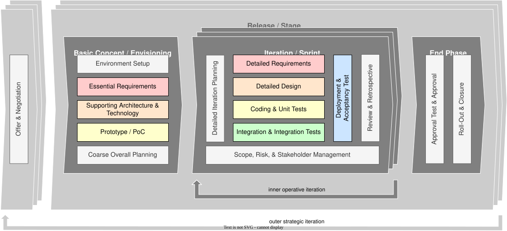
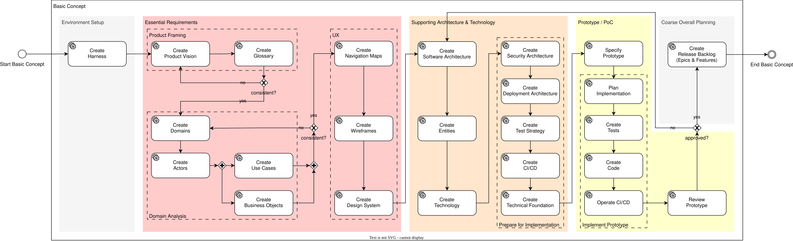
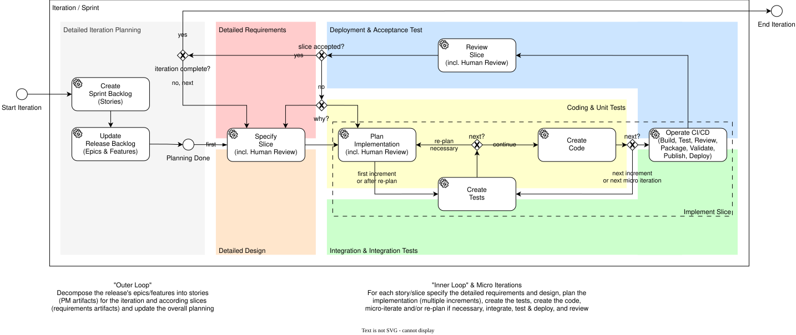

# Agent Workflows

- Status: draft
- Owner: Management
- Last reviewed: 2026-10-13

## Basic Process Model

Our Agentic Software Engineering approach follows this process model. Its two essential delivery phases apply once per project or, for larger initiatives, once per release or stage: a **Basic Concept / Envisioning** phase first establishes a coherent foundation, after which the product evolves through multiple **Iterations / Sprints**. The Basic Concept is not Big Design Up Front; it is a **framework for change** that reduces foundational uncertainty while leaving detailed requirements, design, implementation, and feedback to iterative development. The Agent Workflows below implement this process through bounded agent tasks and introduce a human in the loop wherever review, judgment, or accountable decisions are required.

## Purpose and authority of this document

This document defines how agent tasks establish an initial product and engineering baseline (basic concept) and then evolve it through iterations or sprints. It is the authoritative coordination model for the two graphical main-path views below.

The diagrams deliberately simplify the complete lifecycle. They show important task order, concurrency, review, and feedback but do not replace the owning skill instructions, artifact lifecycle, requirements workflow, backlog workflow, architecture practice, test strategy, or definition of done. Concrete repository skills exist for all agent tasks in these workflows, and the detailed task entries link directly to the applicable `SKILL.md` instructions. If a diagram and this document appear to differ, use this document and record the diagram alignment need.

The current scope defines the individual skills, their task-to-artifact contracts, and their coordination semantics. It does not prescribe whether task selection and orchestration are manual, assisted, or automated:

- each agent task or skill is invoked with a bounded purpose and scope;
- the agent reads the current authoritative artifacts rather than assuming that an earlier result remains correct;
- the agent collaborates with the user, identifies uncertainty, and proposes or applies only the changes authorized for that task;
- the accountable human confirms material product, domain, UX, architecture, planning, and acceptance decisions;
- diagram edges express dependencies, feedback, and coherence needs; they do not by themselves define invocation semantics, change lifecycle status, approve an artifact, or expand implementation authority.

## Operating principles

1. **Artifacts form an evolving product specification.** Requirements, domain models, UX, architecture, decisions, tests, code, infrastructure, and operational evidence must remain linked and mutually consistent.
2. **The flow is iterative, not a sequence of irreversible phase gates.** A later finding may reactivate an earlier task and revise its owning artifact.
3. **Skills are repeatable.** A skill may run in initial-draft, refinement, correction, alignment, or assessment mode. On later runs it uses the current artifact as its baseline, preserves unaffected stable identifiers and user-authored content, and reopens defective assumptions or structures when evidence warrants it.
4. **Artifact ownership remains explicit.** A task updates its owning artifact and produces handoffs for material changes owned elsewhere. It does not silently redefine another artifact to make its own result fit.
5. **Backlog items do not own product intent.** Epics, features, stories, tasks, and defects organize delivery. They link to authoritative requirements and decisions rather than replacing them.
6. **Human review is consequential.** Review challenges completeness, consistency, usability, testability, risk, and evidence. A successful agent run is not equivalent to human approval or artifact acceptance.
7. **Validation is proportional to risk.** Structural checks, diagram rendering, browser review, tests, independent review, and operational evidence are selected according to the affected slice and its consequences.
8. **Main-path diagrams are intentionally incomplete.** Omitted feedback paths, specialist reviews, and cross-cutting concerns still apply through continuous specification alignment and the definition of done.

## Basic Concept workflow

The Basic Concept creates a coherent system-wide baseline and demonstrates that the lifecycle approach can carry at least one representative vertical slice into a prototype or proof of concept. It reduces foundational uncertainty; it does not attempt to specify or design the whole product in implementation detail.

### Main path and diagram areas

The solid fills identify the principal areas; dashed outlines identify nested sub-areas. A dash in the sub-area column means that the task belongs directly to the colored area rather than to a dashed sub-area.

| Color | Area | Dashed sub-area | Main tasks | Intended outcome |
|---|---|---|---|---|
| Gray | Environment Setup | — | Create Harness | A navigable lifecycle repository with governed working conventions and structural validation. |
| Red | Essential Requirements | Product Framing | Create Product Vision; Create Glossary; check consistency | Shared product intent, scope, constraints, exclusions, evidence, and domain language. Material terminology findings may reopen the Product Vision. |
| Red | Essential Requirements | Domain Analysis | Create Domains; Create Actors; Create Use Cases; Create Business Objects; check consistency | A strategic problem-space decomposition whose actors, actor goals, and business concepts can be assigned coherently to subdomains. Use cases and business objects may be developed alongside each other after a sufficient domain and actor baseline exists. |
| Red | Essential Requirements | UX | Create Navigation Maps; Create Wireframes; Create Design System | Actor-facing destinations, interaction hypotheses, and reusable experience guidance derived from actors and use cases without turning UX artifacts into the authoritative business specification. |
| Orange | Supporting Architecture & Technology | — | Create Software Architecture; Create Entities; Create Technology | A justified technology-neutral solution structure, logical Entity Model, and technology baseline derived from requirements, risks, constraints, and decisions. Logical entities are not the problem-space Business Objects or implementation persistence models. |
| Orange | Supporting Architecture & Technology | Prepare for Implementation | Create Security Architecture; Create Deployment Architecture; Create Test Strategy; Create CI/CD; Create Technical Foundation | Security and privacy architecture plus stage-appropriate deployment, test, and delivery baselines; a reusable executable technical foundation. These inputs prepare implementation while retaining their own artifact authority; selected mechanisms alone do not establish security. |
| Yellow | Prototype / PoC | — | Specify Prototype | A bounded prototype specification that defines the representative Slice, technical hypotheses, evidence criteria, and completion conditions before implementation begins. |
| Yellow | Prototype / PoC | Implement Prototype | Plan Implementation; Create Tests; Create Code; Operate CI/CD | One representative vertical slice delivered through the same implementation path intended for regular Slices. |
| Yellow | Prototype / PoC | — | Review Prototype | A technical review of the resulting evidence after Implement Prototype. Review Prototype remains inside Prototype / PoC but outside the dashed implementation sub-area. |
| Gray | Coarse Overall Planning | — | Create Release Backlog (Epics & Features) | Negotiable delivery organization linked to the authoritative product specification and informed by the prototype evidence. |

### Product framing and domain-analysis tasks

The following table records the current task-to-artifact contracts at coordination level. The linked skills remain authoritative for their detailed procedure and readiness criteria.

| Agent task | Principal inputs | Authoritative output or handoff |
|---|---|---|
| [`create-product-vision`](../../../../.agents/skills/create-product-vision/SKILL.md) | Source evidence and stakeholder expertise | Product Vision; constraints and assumptions; scope exclusions; glossary-term and actor candidates rather than authoritative glossary or actor entries. |
| [`create-glossary`](../../../../.agents/skills/create-glossary/SKILL.md) | Product Vision, evidence, constraints, scope exclusions, and domain expertise | Authoritative glossary; meaning-preserving Product Vision reconciliation or a handoff for material intent changes. |
| [`create-domains`](../../../../.agents/skills/create-domains/SKILL.md) | Product Vision, glossary, constraints, scope exclusions, and domain expertise | Strategic domain and subdomain landscape, including unresolved boundary candidates and justified context distinctions. |
| [`create-actors`](../../../../.agents/skills/create-actors/SKILL.md) | Product intent, glossary, domain boundaries, constraints, scope exclusions, and actor candidates | Authoritative actor catalog. |
| [`create-use-cases`](../../../../.agents/skills/create-use-cases/SKILL.md) | Product intent, glossary, subdomains, actors, constraints, and scope exclusions | Actor-goal use-case catalog with exactly one primary subdomain per use case. |
| [`create-business-objects`](../../../../.agents/skills/create-business-objects/SKILL.md) | Glossary, subdomains, representative use cases, constraints, and scope exclusions | Problem-space business-object catalog with exactly one primary subdomain per object. |

Product Vision and Glossary form the first explicit consistency loop. Domains, Actors, Use Cases, and Business Objects form a second consistency loop: actor goals and business concepts may reveal an incorrect boundary, missing subdomain, ambiguous term, or actor conflation and therefore reactivate an earlier task.

### UX tasks

| Agent task | Principal inputs | Authoritative output or handoff |
|---|---|---|
| [`create-navigation-map`](../../../../.agents/skills/create-navigation-map/SKILL.md) | Product intent, actors, actor goals, use cases, glossary, constraints, scope exclusions, and relevant UX evidence | Authoritative information architecture and navigation map covering actor-facing destinations, entry points, transitions, and unresolved navigation questions. |
| [`create-wireframes`](../../../../.agents/skills/create-wireframes/SKILL.md) | Relevant actors, use cases, acceptance examples, navigation map, constraints, and UX evidence | Annotated low-fidelity wireframes covering information, actions, states, feedback, and recovery, with browser-viewable HTML renderings where useful. |
| [`create-design-system`](../../../../.agents/skills/create-design-system/SKILL.md) | Representative navigation and wireframes, quality requirements, constraints, accessibility needs, and UX evidence | Requirements-level design-system guidance for semantic foundations, interaction patterns, reusable components, content, and validation criteria. |

The three UX tasks retain distinct authority: the Navigation Map owns information architecture and navigation relationships, Wireframes own interaction frames and states, and the Design System owns reusable experience guidance. None of them replaces actor goals, use-case behavior, business rules, or acceptance evidence.

### From catalog coverage to a representative slice

The Basic Concept diagram abbreviates the transition from the system-wide use-case catalog to slice-specific UX and the PoC. For a selected representative use case:

1. Use [`specify-use-case`](../../../../.agents/skills/specify-use-case/SKILL.md) to elaborate one cataloged actor goal in Cockburn style, including scenarios, extensions, guarantees, concerns, and acceptance examples.
2. Select a coherent vertical slice when the complete use case is too broad for the prototype. The slice is delivery scope, not a redefinition of the actor goal.
3. Use [`create-navigation-map`](../../../../.agents/skills/create-navigation-map/SKILL.md) to establish or align actor-facing destinations and entry points at the product coverage requested by the user.
4. Use [`create-wireframes`](../../../../.agents/skills/create-wireframes/SKILL.md) to define the relevant interaction frames, states, feedback, and recovery. Browser-viewable HTML may render these hypotheses when clickability materially improves validation; Markdown remains authoritative.
5. Use [`create-design-system`](../../../../.agents/skills/create-design-system/SKILL.md) to derive and align reusable experience foundations and patterns across representative wireframes.

UX artifacts may begin with a selected slice while retaining broader product-level navigation or reusable guidance where that is useful and evidenced. They must not describe omitted product behavior as out of scope merely because the current prototype does not implement it.

### Supporting architecture and technology tasks

| Agent task | Principal inputs | Authoritative output or handoff |
|---|---|---|
| [`create-software-architecture`](../../../../.agents/skills/create-software-architecture/SKILL.md) | Domains, use cases, business objects, cross-cutting requirements, constraints, quality drivers, and decisions | Technology-neutral modules, internal dependency structure, module contracts and interactions, consistency boundaries, and justified distribution strategy. |
| [`create-entities`](../../../../.agents/skills/create-entities/SKILL.md) | Business objects, representative use cases and rules, software modules, contracts, consistency expectations, constraints, and decisions | Technology-neutral logical Entity Model with stable entities, value structures, relationships, integrity boundaries, and exactly one owning module per entity. |
| [`create-technology`](../../../../.agents/skills/create-technology/SKILL.md) | Software Architecture, Logical Entity Model, requirements, constraints, quality drivers, security concerns, delivery and operational needs, and applicable decisions | Justified technology baseline covering selected products and mechanisms, their usage boundaries, alternatives, compatibility and version policy, non-selections, and validation needs. |

The three tasks retain distinct authority: module structure does not define logical entities, the Entity Model does not define persistence products or physical schemas, and the Technology Baseline does not silently redefine architecture or prove security outcomes. The diagram presents a useful initial progression from structure through entities to technology, but the tasks remain iterative.

### Prepare for Implementation tasks

Within the orange Supporting Architecture & Technology area, the dashed **Prepare for Implementation** sub-area groups the following five tasks. They establish the security, environment, verification, delivery, and executable-foundation inputs needed by the Prototype / PoC. Their grouping does not transfer their artifact authority to the prototype or make their outputs disposable; each establishes a reusable baseline at the depth required for the current stage and explicitly defers later-environment and production concerns that lack evidence.

| Agent task | Principal inputs | Authoritative output or handoff |
|---|---|---|
| [`create-security-architecture`](../../../../.agents/skills/create-security-architecture/SKILL.md) | Product scope, actors, use cases, information sensitivity and lifecycle, modules, entities, technology context, constraints, quality requirements, external boundaries, risks, and decisions | Protected assets, trust boundaries, threat treatment, identity and authorization boundaries, security responsibility allocation, control objectives, prototype security profile where relevant, and verification expectations. |
| [`create-deployment-architecture`](../../../../.agents/skills/create-deployment-architecture/SKILL.md) | Software Architecture; Technology Baseline; Security and Privacy Architecture; quality constraints; delivery, review, data, isolation, and operational needs | A concrete environment landscape plus only those environment specifications needed for prototype implementation, review, and the foreseeable next delivery stage; unsupported later environments remain explicitly deferred. |
| [`create-test-strategy`](../../../../.agents/skills/create-test-strategy/SKILL.md) | Representative requirements and acceptance evidence; quality risks; Software Architecture; Technology Baseline; Security and Privacy Architecture; Deployment Architecture; delivery and review needs | A reusable test and evidence baseline covering proportionate test levels, responsibilities, data and environment use, automation boundaries, human review, result handling, and readiness gates. |
| [`create-ci-cd`](../../../../.agents/skills/create-ci-cd/SKILL.md) | Harness; Technology Baseline; Security and Privacy Architecture; Deployment Architecture; Test Strategy; current repository and delivery capabilities | A reusable CI/CD baseline and the minimum verification, build, packaging, evidence, and authorized delivery contract required for the prototype and subsequent iterations, with unsupported later capabilities explicitly deferred. |
| [`create-technical-foundation`](../../../../.agents/skills/create-technical-foundation/SKILL.md) | Reviewed Software Architecture, Logical Entity Model, Technology, Security, Deployment Architecture, Test Strategy, and CI/CD baseline; repository structure and current executable capabilities | A reusable executable foundation containing only the authorized project structure, dependency and build path, module-boundary mechanisms, test facilities, migration mechanism, local runtime, configuration, and delivery automation needed for the prototype and foreseeable regular Slices, together with focused smoke evidence. It does not implement actor-goal behavior, prototype-specific UX, or speculative infrastructure. |

The five tasks retain distinct authority: Security Architecture does not silently redefine business authorization or legal obligations, deployment specifications do not select product behavior, the Test Strategy does not create individual tests, the CI/CD baseline does not operate a delivery run, and the Technical Foundation does not implement a prototype Slice. Security and privacy drivers apply throughout, and findings may reopen Software Architecture, Entities, Technology, Requirements, or another owning artifact. **Create Technical Foundation** follows the security, deployment, test, and CI/CD baselines and precedes prototype specification.

### Prototype and PoC tasks

Within the yellow Prototype / PoC area, **Specify Prototype** establishes the prototype boundary before the dashed **Implement Prototype** sub-area runs **Plan Implementation**, **Create Tests**, **Create Code**, and **Operate CI/CD**. **Review Prototype** follows that sub-area while remaining inside Prototype / PoC. The plan may organize implementation into increments; the reviewed plan and applicable tests govern that work. **Review Prototype** remains specialized because it assesses the prototype's architecture and technology hypotheses rather than accepting the correctness of the business specification.

As an optional alternative, [`implement-prototype`](../../../../.agents/skills/implement-prototype/SKILL.md) performs the entire **Implement Prototype** assignment directly when a stronger model can reliably manage its combined complexity. It plans, tests, codes, executes the established authorized delivery path, corrects implementation defects, and captures evidence without invoking the individual delivery skills. Both paths preserve the same fixed inputs, Technical Foundation prerequisite, durable plan, required human review, raw-evidence contracts, and subsequent **Review Prototype** boundary. The diagram shows the decomposed responsibilities; it does not require separate invocations when this alternative is selected. [DR-0029](../../decisions/0029-adopt-oculus-lifecycle-skills-and-templates.md) records this bounded addition.

| Agent task | Principal inputs | Authoritative output or handoff |
|---|---|---|
| [`specify-prototype`](../../../../.agents/skills/specify-prototype/SKILL.md) | Selected cataloged actor goal or candidate slice; sufficiently detailed use-case behavior initiated through `specify-use-case` where needed; acceptance examples; navigation, wireframes, and design-system guidance; Software Architecture; Logical Entity Model; Technology Baseline; Security and Privacy Architecture; Deployment Architecture; Test Strategy; constraints; quality concerns; CI/CD capability; and relevant decisions | A draft or refined prototype specification, normally `docs/implementation/prototype.md`, defining the selected slice, hypotheses, included and excluded behavior, provisional prototype treatments, solution mapping, security restrictions, evidence scenarios, completion and abort criteria, and unresolved questions without creating implementation code. |
| [`implement-prototype`](../../../../.agents/skills/implement-prototype/SKILL.md), optional complete-assignment alternative | Reviewed prototype specification; usable Technical Foundation; routed fixed behavior and UX; applicable architecture, entity, technology, security, deployment, test, and CI/CD constraints; current repository state and prior evidence when resuming | One scope-specific Implementation Plan, executable tests and implementation, authorized delivery execution, and current reproducible raw evidence ready for Prototype review. A stronger model performs all these responsibilities directly; this is an alternative to the following four delivery tasks, not an additional stage. |
| [`plan-implementation`](../../../../.agents/skills/plan-implementation/SKILL.md) | Reviewed prototype specification; executable Technical Foundation; routed requirements and UX anchors used as fixed implementation inputs; relevant architecture, entity, technology, security, deployment, test, and CI/CD constraints | A reviewed implementation plan that maps the bounded prototype Slice to coherent increments, affected code and data areas, required tests, migration and integration work, exit conditions, and executable checks without redefining the charter or its authoritative inputs. |
| [`create-tests`](../../../../.agents/skills/create-tests/SKILL.md) | Reviewed prototype specification and implementation plan; acceptance examples and evidence scenarios; Test Strategy; executable test facilities from the Technical Foundation | Executable unit and integration tests, fixtures, and traceability needed for the declared architecture and technology evidence. In the Iteration diagram, the same task spans the Coding & Unit Tests and Integration & Integration Tests areas and completes both applicable test responsibilities before code creation proceeds. |
| [`create-code`](../../../../.agents/skills/create-code/SKILL.md) | Reviewed prototype specification and implementation plan; executable Technical Foundation; created tests; routed architecture, entity, technology, security, and UX constraints | Source code, migrations, configuration, and other implementation artifacts that realize the bounded prototype Slice without broadening business behavior or weakening the planned evidence. |
| [`operate-ci-cd`](../../../../.agents/skills/operate-ci-cd/SKILL.md) | Identified source state; implementation, tests, migrations, configuration, build definition, target environment contract, and CI/CD baseline | Proportionate build, test, review, packaging, validation, publication, and deployment execution for the authorized stage, with reproducible raw evidence and explicit failures or skipped checks. |
| [`review-prototype`](../../../../.agents/skills/review-prototype/SKILL.md) | Prototype specification and declared architecture and technology hypotheses; executable result; automated and manual evidence; relevant architecture, entity, technology, security, deployment, test, delivery, and implementation artifacts; known deviations and residual risks | An explicit assessment of each architecture and technology hypothesis and completion criterion, recorded evidence and limitations, an approval recommendation, and targeted technical handoffs. Prototype review does not validate business correctness and does not confer approval by itself. |

`prototype.md` is the authoritative charter and evidence index for the selected prototype. Before implementation it states the technical hypotheses, representative Slice, provisional treatments, and evidence by which architecture and technology will be judged. During and after execution it links the resulting evidence and records whether each hypothesis is supported, rejected, or inconclusive. Requirements and UX provide fixed representative behavior for the exercise; Prototype Review does not determine whether that behavior is the correct business intent. Source code, migrations, executable configuration, test code, and generated reports remain authoritative in their own repositories or artifact locations rather than being copied into the charter.

The `approved?` gateway follows Prototype Review. Approval is an accountable decision that the available evidence supports continuing with the tested architecture and technology direction; it is not an automatic consequence of successful execution or passing tests and does not accept the represented business behavior. The diagram deliberately returns a rejected result to Software Architecture as the earliest main-path entry into the architecture-and-technology chain. The specific finding remains owned by Software Architecture, Entities, Technology, Security, Deployment Architecture, Test Strategy, CI/CD, the Technical Foundation, the implementation plan, tests, code, or delivery execution as applicable. Reactivate `specify-prototype` only when the technical hypothesis, representative boundary, provisional treatment, or evidence criterion itself is defective.

### Coarse Overall Planning tasks

| Agent task | Principal inputs | Authoritative output or handoff |
|---|---|---|
| [`create-release-backlog`](../../../../.agents/skills/create-release-backlog/SKILL.md) | Product scope; representative requirements and UX evidence; architecture, technology, security, and validation evidence; dependencies, risks, constraints, and planning questions | An evidence-backed Release Backlog of outcome-oriented Epics and independently evaluable Features with stable identifiers, authoritative anchors, coarse dependencies, sequencing, and open planning questions. |

Release-backlog levels use correspondence as a derivation heuristic rather than an identity rule: epics often align with domains or subdomains, features often align with use cases, and stories often align with use-case slices. Every item retains one clear parent where the hierarchy requires it, identifies its primary authoritative anchors, and explains justified cross-domain, split-use-case, combined-use-case, or cross-use-case scope. The Basic Concept establishes epics and sufficiently evidenced features; stories are normally refined during iteration planning rather than created speculatively.

### PoC as an iteration-like Sprint 0

The PoC is part of the Basic Concept but should exercise the same delivery discipline expected in later iterations. Deployment Architecture, Test Strategy, and CI/CD establish the reusable declarative baselines. **Create Technical Foundation** realizes their minimum reusable executable mechanisms before a prototype-specific Slice is planned. `specify-prototype` then establishes the representative actor-goal slice, architecture and technology hypotheses, provisional treatments, and intended evidence.

After specification, the prototype uses the same inner delivery responsibilities as a regular Slice: **Plan Implementation**, **Create Tests**, **Create Code**, and **Operate CI/CD**. These may run through the shared decomposed chain or, for a stronger model capable of the combined complexity, directly within the optional **Implement Prototype** skill. The prototype-specific **Review Prototype** assesses whether the resulting evidence supports the declared architecture and technology hypotheses. The representative business behavior is an implementation input and test vehicle, not an object of correctness validation in this review.

Prototype approval means that the available evidence supports continuing with the tested architecture and technology direction under the recorded limitations. It does not accept requirements, domain behavior, UX intent, or every contributing architecture, security, implementation, and delivery artifact. Technical findings may reactivate their owning Basic Concept task or the affected shared delivery task before release planning continues.

### Basic Concept readiness

The Basic Concept is ready to hand work into recurring iterations when, proportionate to the intended next slice:

- product intent, scope, constraints, exclusions, and core language are coherent enough to guide delivery;
- strategic subdomains, actors, use-case coverage, and business objects provide a reviewable problem-space baseline;
- at least one representative use case or slice is detailed enough for UX, design, test, and implementation planning;
- representative navigation, wireframes, and design-system guidance expose material usability, accessibility, privacy, and recovery questions;
- architecture, logical-entity, technology, and security choices needed for the next slice are justified or explicitly deferred;
- the deployment, test, and CI/CD baselines required for the current stage are explicit, the reusable Technical Foundation is executable, and the PoC provides evidence about the selected architecture, technology, and technical delivery path;
- release-backlog items link to authoritative specifications rather than duplicating their ownership;
- unresolved matters have owners and resolution conditions, and applicable definition-of-done checks have been performed.

Readiness is contextual. It does not mean that every system-wide artifact is complete, accepted, or frozen.

## Iteration or Sprint workflow

Each iteration combines an outer planning loop with an inner vertical-slice loop. The outer loop decomposes release Epics and Features into iteration Stories and keeps their Slice traceability current. The inner loop delivers one reviewed Slice through planned implementation increments, with micro-iterations or re-planning when feedback requires them. The diagram describes dependencies and review points without prescribing how the relevant tasks are selected, invoked, or coordinated.

### Diagram-area mapping

The Iteration diagram uses task placement across colored boundaries deliberately. A boundary-spanning task contributes to both adjacent areas; it is not assigned exclusively according to the position of its label or center point.

| Color and area | Diagram task assignment | Coordination meaning |
|---|---|---|
| Gray — Detailed Iteration Planning | Create Sprint Backlog (Stories); Update Release Backlog (Epics & Features) | Establish the iteration plan and keep the release-level planning view aligned. |
| Red — Detailed Requirements and Orange — Detailed Design | Specify Slice (including Human Review) spans their boundary | Specify Slice coordinates the detailed requirements and design inputs for one coherent Slice without taking authority away from their owning artifacts or skills. |
| Yellow — Coding & Unit Tests | Plan Implementation (including Human Review); Create Code | The reviewed implementation plan structures the increments, and Create Code realizes the current increment with its unit-level feedback. |
| Yellow — Coding & Unit Tests and Green — Integration & Integration Tests | Create Tests spans their boundary | One task creates the applicable unit and integration tests while preserving the distinction between their evidence responsibilities. |
| Green — Integration & Integration Tests and Blue — Deployment & Acceptance Test | Operate CI/CD spans their boundary | One delivery task integrates and tests the increment and performs only the authorized build, review, packaging, validation, publication, and deployment steps. |
| Blue — Deployment & Acceptance Test | Review Slice (including Human Review) | Review the completed Slice and its evidence before the acceptance decision. |

### Outer loop: iteration planning

1. Start from current product evidence, accepted or draft specifications, release goals, backlog, prior review findings, operational evidence, and unresolved risks.
2. Use [Create Sprint Backlog](../../../../.agents/skills/create-sprint-backlog/SKILL.md) to create or refine Stories, assigning or preserving their durable tracker-independent `ST-NNN` identifiers.
3. Use [Update Release Backlog](../../../../.agents/skills/update-release-backlog/SKILL.md) to align affected Epics and Features with selected Stories, preserving links from those Stories to their Slice specifications as the Slices are defined.
4. Agree the iteration goal, timebox, capacity basis, accepted load, selected Stories, sequence, dependencies, review needs, assumptions, risks, and replanning conditions with the team.
5. Mark planning ready only when the selected Story that enters the inner loop is explicit. **Specify Slice** establishes the concrete Slice boundary and may refine the overall planning when that boundary changes the agreed load, sequence, or dependencies.

The outer loop may be revisited during the iteration when scope, evidence, dependencies, capacity, or risk changes. Backlog changes alone do not change the authoritative Product Vision, use cases, rules, quality requirements, or decisions.

### Inner loop: one slice at a time, delivered in increments

1. **[Specify Slice](../../../../.agents/skills/specify-slice/SKILL.md), including human review.** Start from one selected Sprint Backlog Story, agree one coherent boundary inside its planning mandate, elaborate or correct every affected authoritative artifact through its owning skill, and create or update the stable `SL-NNN` Slice Manifest. The reviewed Manifest composes the inputs for implementation planning without replacing use cases, rules, quality requirements, UX, architecture, security, deployment, test intent, or other owning artifacts.
2. **[Plan Implementation](../../../../.agents/skills/plan-implementation/SKILL.md), including human review.** Derive implementation intent from the reviewed slice and accepted architecture. Record consequential architecture, technology, or security choices rather than hiding them in code.
3. **[Create Tests](../../../../.agents/skills/create-tests/SKILL.md).** After implementation planning, create the applicable unit and integration tests for the planned increments. This task spans the diagram's **Coding & Unit Tests** and **Integration & Integration Tests** areas and owns both test responsibilities without conflating their levels or evidence semantics. Test design challenges ambiguity and covers the Slice's normal, alternative, error, boundary, integration, and quality behavior proportionately. Test work may expose specification defects and reopen the Slice. When a test category is not applicable, record that result and rationale rather than silently omitting it.
4. **[Create Code](../../../../.agents/skills/create-code/SKILL.md).** Implement each planned increment against the reviewed Slice, implementation plan, and applicable tests without silently broadening product scope.
5. **[Operate CI/CD](../../../../.agents/skills/operate-ci-cd/SKILL.md).** Integrate the increment and run the checks and evidence appropriate to the planned delivery points; complete the applicable Slice gate before review. Build, test, review, package, validate, publish, and deploy only as appropriate to the environment and authorized delivery stage.
6. **Micro-iterate or re-plan when needed.** After **Create Tests**, continue to **Create Code** or return to **Plan Implementation** when re-planning is necessary. After **Create Code**, continue to **Operate CI/CD** when the planned Slice work is ready for the delivery path, or return to **Create Tests** for the next increment or micro-iteration. If the Slice boundary or an authoritative input must change, route back through **Specify Slice**. Do not repeat downstream work from an unchanged or unreviewed plan.
7. **[Review Slice](../../../../.agents/skills/review-slice/SKILL.md), including human review.** After the planned Slice work and required evidence are complete, compare requirements, UX, architecture, tests, implementation, delivered behavior, and evidence. Record unresolved divergence rather than treating pipeline success as acceptance.
8. **Decide slice acceptance.** If the slice is accepted, continue to the iteration-completeness decision. If it is not accepted, use the exclusive `why?` decision to route the finding according to the earliest reviewed input that must change:
   - return to **Specify Slice** when the slice specification or an authoritative requirement, domain, UX, acceptance, architecture, technology, security, or test-intent input must change; after the corrected slice is reviewed, continue through implementation planning again;
   - return directly to **Plan Implementation** only when the reviewed slice specification remains valid but the implementation intent must change.
9. **Require a reviewed upstream change before repeating execution.** Rejection or a re-planning decision alone does not retrigger test creation, code creation, or CI/CD. Those downstream tasks run again only after the affected Slice specification or implementation plan has actually changed and completed its human review. If neither input needs to change, keep the issue unresolved and obtain the missing evidence or decision instead of repeating unchanged work.
10. **Decide iteration completeness.** After an accepted Slice, end the iteration when its planned outcomes and required evidence are complete or an explicit planning decision has changed them. If the iteration is not complete, return to **Specify Slice** for the next planned Story or Slice.

### Reactivating earlier tasks

Later work commonly reveals that an earlier artifact is incomplete or wrong. Reactivate the owning skill when, for example:

- stakeholder evidence changes product intent, scope, constraints, or exclusions;
- a term becomes ambiguous across subdomains;
- a use case or business object does not map coherently to one primary subdomain;
- a detailed scenario exposes a missing actor, boundary, rule, failure, or guarantee;
- UX validation changes a destination, frame, state, label, or reusable design pattern;
- architecture, technology, test, implementation, security, privacy, accessibility, or operational evidence contradicts an assumption;
- a slice review discovers divergence among specification, tests, implementation, and observed behavior.

Reactivation is corrective evolution, not workflow failure. Preserve stable identifiers when meaning continues; retire rather than reuse them when it does not. Update affected artifacts in one coherent change where practical.

When a rejected slice exposes a defect in an earlier authoritative artifact, reactivate its owning skill before completing the **Specify Slice** correction. When the earlier artifact remains valid and only realization intent changes, correct **Plan Implementation** instead. In both cases, downstream test, code, and delivery tasks resume only from the resulting reviewed change; the feedback path does not authorize blind repetition of unchanged work.

## Lifecycle task protocol

Use this protocol whenever starting or resuming a lifecycle agent task, independently of how the task was selected or invoked:

1. Select the task or skill and state the intended mode: initial draft, refinement, correction, alignment, or assessment.
2. State the product, iteration, use case, slice, and artifacts in scope; do not infer delivery scope solely from artifact status.
3. Read this workflow, the relevant skill, the documentation context map, and the owning and directly affected artifacts.
4. Let the agent propose a current understanding and investigate material gaps with the user as domain, product, UX, architecture, or delivery expert.
5. Confirm the understanding before material writes unless the user explicitly requests a provisional draft.
6. Update authoritative artifacts and derived views together where practical; preserve IDs and record handoffs for changes outside the task's ownership.
7. Render or execute diagrams, HTML views, tests, and other validation appropriate to the change.
8. Apply the artifact lifecycle and definition of done, report skipped checks and residual uncertainty, and leave acceptance to the accountable authority.

## Relationship to other governance

- [Artifact Authority and Lifecycle](../artifact-lifecycle.md) defines statement types, artifact ownership, stable identifiers, and lifecycle states.
- [Requirements Engineering Workflow](../requirements-workflow.md) governs requirements slices and requirements review.
- [Continuous Specification Alignment](../continuous-spec-alignment.md) governs propagation of changes across lifecycle artifacts.
- [Modular Software Architecture](../modular-software-architecture.md) governs iterative derivation and refinement of modules and dependencies.
- [Commit Workflow](../commit-workflow.md) governs repository change integration when version control is in use.
- [Definition of Done](../definition-of-done.md) defines completion evidence and required checks.
- [Software Development Life Cycle (SDLC) responsibility model](../../lifecycle/lifecycle.md) defines lifecycle responsibilities, authority boundaries, independent challenge perspectives, and collaboration rules.
- [DR-0029](../../decisions/0029-adopt-oculus-lifecycle-skills-and-templates.md) adopts the shared decomposed delivery chain for Prototype and regular Slices, plus the optional complete Prototype implementation assignment, in A3SE-App.
- [Repository skills](../../../../.agents/skills/README.md) provide task-specific procedures.
- [Templates](../../templates/README.md) provide canonical structures for governed artifacts.

## Known simplifications and open questions

- The diagrams show the principal flow, not every valid feedback edge, specialist review, cross-cutting concern, or parallel activity.
- Product Framing, Domain Analysis, UX, architecture, test, implementation, and planning may overlap when evidence and task boundaries permit it; the arrows express dependency and coherence, not mandatory calendar phases.
- The Basic Concept diagram places **Prepare for Implementation** inside Supporting Architecture & Technology, before the Prototype / PoC area, and places **Implement Prototype** inside Prototype / PoC between **Specify Prototype** and **Review Prototype**. This document names the tasks in both sub-areas and describes their handoffs. Both the prototype and regular Slices use the planning, test, code, and delivery responsibilities shown by **Plan Implementation**, **Create Tests**, **Create Code**, and **Operate CI/CD**. For the prototype, the optional **Implement Prototype** skill can perform those responsibilities directly when the model can handle the combined complexity. **Review Prototype** and **Review Slice** retain different decision semantics.
- The Iteration diagram summarizes micro-iterations and re-planning within a Slice. This document describes how feedback advances to another increment or reviewed plan and how a material Slice or authoritative-input change returns to **Specify Slice**.
- The exact relationship among Epics, Features, Stories, requirements slices, and external project-management tooling remains governed by backlog decisions and templates and may evolve independently of the requirements artifacts.
- Task-selection and orchestration mechanisms are outside the current scope while the individual skills and their contracts are being established. Any such mechanism must preserve human authority, skill boundaries, evidence requirements, safe stopping conditions, and repeatable corrective invocation.
